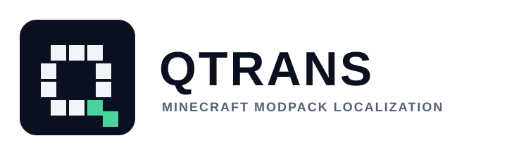

# QTrans — Minecraft 模組包任務漢化工具



[](https://github.com/fengnaiouo/QTrans/actions/workflows/ci.yml)
[](https://github.com/fengnaiouo/QTrans/releases)
[](./LICENSE)

針對 **FTB Quests** 與 **KubeJS** 的 Minecraft 模組包漢化工具，輸出繁體中文（`zh_tw`）。

- 核心／CLI／GUI：**Rust**
- 機翻服務：**Go**（批次、快取、術語保護、多供應商）
- GUI：**GPUI**（Zed 的 Rust UI 框架）

---

## 功能

| 功能 | 說明 |
| --- | --- |
| ZIP 解包 | 自動辨識 CurseForge 的 `overrides/` 結構 |
| 字串掃描 | 解析 FTB Quests `.snbt`、KubeJS `assets/*/lang/en_us.json`，以及腳本中明確面向玩家的文字 |
| 無損回寫 | SNBT 與 KubeJS 腳本以位元組跨度替換，保留原檔格式、註解和非翻譯程式碼 |
| 機翻 | Google 免費端點（免金鑰）、OpenAI 相容 API、DeepL、離線術語表、測試用 mock |
| 術語保護 | 模組名、`%s`、`{key}`、`\n`、資源 ID 會先換成 `{pN}` / `{gN}` 再送翻（顏色碼交給 Google 自行保留） |
| 翻譯快取 | SHA-256 去重快取，重跑不會重複花費 |
| 可續傳 | `translations.jsonl` 逐批寫入，中斷後再執行會接續 |
| 人工校訂 | GUI 可逐筆檢視來源情境、修訂翻譯並保存至專案記錄 |
| 一鍵流程 | 解包 → 掃描 → 機翻 → 回寫 → 重新打包 |
| 兩種輸出 | 完整 modpack ZIP + 只含變更檔案的 `overrides/` 資料夾 |

---

## 目錄結構

```
crates/
  qtrans-core/    解析、掃描、回寫、打包（純 Rust）
  qtrans-cli/     命令列工具 qtrans
    src/cli.rs          命令列參數與子命令
    src/commands.rs     各命令的工作流程
    src/translation.rs  服務請求、翻譯快取重用與術語表
  qtrans-gui/     GPUI 圖形介面 qtrans-gui
    src/app/      專案狀態、設定、校訂、專案操作、翻譯流程與子程序
    src/app/ui/   工作台、校訂、專案卡、設定、流程、統計、日誌與共用元件
    src/theme.rs  GUI 色彩主題
go/translator/    Go 翻譯服務（啟動、HTTP handler、provider、快取及字串保護分檔）
assets/brand/     QTrans 原創 SVG 標誌、圖示及品牌預覽頁
bin/              建置產物（qtrans-translator.exe）
modpacks/         放原始模組包 ZIP
work/
  projects/<pack>-<zip-sha256>/  解包內容、strings.jsonl、translations.jsonl、manifest.json
  output/           全域輸出（若使用 --out）
  cache/            翻譯快取
```

所有操作都只會寫入本專案資料夾，不會動到系統暫存目錄。
專案目錄名稱會附上來源 ZIP 的 SHA-256 前綴，不同內容但檔名相同的模組包不會共用翻譯狀態。

---

## 建置

需求：Rust stable、Go 1.24+（Windows / macOS / Linux）。

```powershell
# Rust 核心 + CLI + GUI
cargo build --release

# Go 翻譯服務
cd go/translator
go build -ldflags "-X main.version=0.1.4" -o ../../bin/qtrans-translator.exe .
cd ../..
```

開發時可用 `rtk` 過濾輸出（省 token）：

```powershell
rtk cargo build
rtk cargo test
rtk go build ./...
```

或直接執行 `scripts/build.ps1`。

---

### Windows 安裝包

需求：Windows、Rust stable、Go 1.24+、Inno Setup 6 或更新版本。安裝 Inno Setup 後，
在 Windows 開發環境執行：

```powershell
.\scripts\package-windows.ps1
```

腳本會自動尋找 `ISCC.exe`（PATH、安裝登錄資訊及預設安裝位置），並產生
`dist\QTrans-Setup-x64.exe`。安裝程式內含 GUI、CLI、Go 翻譯服務及完整資料夾結構；
執行後依 Inno Setup 精靈選擇安裝位置，完成後可直接啟動 QTrans。預設安裝於目前使用者的
`%LOCALAPPDATA%\Programs\QTrans`，不需要系統管理員權限。重新安裝會更新程式檔，但保留既有的
`work/`、`modpacks/` 和 `zip/` 內容。解除安裝會移除程式與捷徑；翻譯專案、模組包與輸出資料
預設會保留，安裝程式會詢問是否一併刪除，預設選項為「否」。若安裝目錄還有非 QTrans 管理的
檔案，或您選擇保留使用者資料，目錄會保留並提示位置。

GUI 右上角的「檢查更新」會查詢本專案 GitHub Releases。若發現較新的版本，可下載並啟動該
版本的 Inno Setup 安裝程式；安裝前仍會由安裝精靈確認，不會在背景無提示覆寫程式。
下載的安裝程式暫存於 `work/updates/`，下次下載時會清理先前的檔案。
封裝時若 Inno Setup 提供繁體中文語系檔，安裝精靈會使用繁體中文；否則使用英文。
目前尚未發布 Release 時會顯示提示。維護者需將 `Cargo.toml` 的 workspace 版本更新後，
推送相同版本的 `v<版本>` 標籤（例如 `v0.2.0`）；GitHub Actions 會建置並發布安裝程式，
供 GUI 更新檢查使用。

## 快速開始

### 1. 啟動翻譯服務

```powershell
.\bin\qtrans-translator.exe
# http://127.0.0.1:8787
```

服務預設只監聽 `127.0.0.1`，不開放跨來源瀏覽器請求。無金鑰時使用 `google_free`（Google 翻譯公開端點）。
要更好的品質可設定 OpenAI 相容 API：

```powershell
$env:OPENAI_API_KEY="sk-..."
$env:OPENAI_BASE_URL="https://api.openai.com/v1"   # 或任何相容端點
$env:OPENAI_MODEL="gpt-4o-mini"
.\bin\qtrans-translator.exe
```

### 2. 一鍵漢化

```powershell
.\target\release\qtrans.exe run "modpacks\All-The-Mods-9-Expert-0.7.0.zip"
```

輸出：

```
work/projects/All-The-Mods-9-Expert-0-7-0-<zip-sha256>/output/All-The-Mods-9-Expert-0.7.0-zh_tw.zip
work/projects/.../output/...-zh_tw-overrides/   # 只含變更檔案
```

### 3. 圖形介面

```powershell
.\target\release\qtrans-gui.exe
```

GUI 會呼叫同目錄的 `qtrans.exe`，可選擇 ZIP、逐步執行或一鍵完成。
主畫面以專案選擇和四步流程為主，翻譯設定、進度統計、逐筆人工校訂與執行日誌分頁呈現；
設定摘要會顯示供應商、目標語言和批次大小，API 金鑰欄位只會在選到相應供應商時顯示。
工作台與設定頁會說明翻譯文字及情境的傳送對象；選用線上供應商時請勿傳送敏感內容。
翻譯進度會隨 CLI 的掃描與批次結果即時更新字串總數、專案已譯、本次新譯、快取沿用、失敗數與目前批次，不必等整個流程結束。
校訂頁可檢視來源文字、檔案及情境，修改並保存單筆翻譯；未儲存修改時會阻止切換，人工記錄可在後續回寫流程套用。
執行紀錄以易讀的流程名稱呈現，並區分進行中、完成、資訊、警告與錯誤；最多保留 600 筆，提供可見的垂直捲動條並可點擊快速定位。
預設自動跟隨新紀錄，可暫停跟隨以檢視舊紀錄，再按「跟隨最新」回到底部。
文字欄位支援游標左右移動、Home／End、Backspace／Delete、Ctrl+A 選取和 Ctrl+V 貼上。
OpenAI／DeepL 金鑰只在 GUI 執行期間保留於記憶體，啟動本機 Go 服務時傳入，
不會寫入專案設定檔。Windows 版 GUI 使用視窗子系統啟動，不會額外彈出終端視窗。

---

## 命令列

```text
qtrans extract <zip> [--work work] [--target zh_tw]
qtrans scan    --project <dir>
qtrans translate --project <dir> [--provider google_free|openai|deepl|offline|mock]
                  [--service http://127.0.0.1:8787] [--model gpt-4o-mini]
                  [--limit N] [--batch-size N] [--overwrite]
qtrans apply   --project <dir>
qtrans build   --project <dir> [--out <zip>]
qtrans status  --project <dir>
qtrans run     <zip> [--provider ...] [--service ...] [--skip-translate] [--limit N]
                  [--batch-size N] [--overwrite]
```

安裝版不會自動把 `qtrans.exe` 加入系統 `PATH`；請在安裝目錄執行 `.\qtrans.exe`，或自行將該目錄加入 `PATH`。

建議流程：

```powershell
qtrans extract "modpacks\xxx.zip"
qtrans scan --project work\projects\xxx
qtrans translate --project work\projects\xxx --limit 50   # 先試翻 50 條
qtrans translate --project work\projects\xxx              # 續翻其餘
qtrans apply --project work\projects\xxx
qtrans build --project work\projects\xxx
```

---

## 翻譯供應商

| provider | 金鑰 | 說明 |
| --- | --- | --- |
| `google_free` | 不需要 | 預設。公開端點，速度快，品質中等 |
| `openai` | `OPENAI_API_KEY` | 品質最好，支援術語與上下文。任何 OpenAI 相容服務皆可（DeepSeek、Ollama、LM Studio…） |
| `deepl` | `DEEPL_API_KEY` | DeepL API，`zh-TW` 會轉成 `ZH-HANT` |
| `offline` | 不需要 | 只套用 `glossary.csv`，其餘保留英文 |
| `mock` | 不需要 | 測試流程用，輸出「【譯】原文」；僅供 CLI／開發測試，GUI 設定頁不提供 |

其他環境變數：

- `QTRANS_ADDR`：服務位址（預設 `127.0.0.1:8787`）
- `QTRANS_CACHE`：快取檔（預設 `work/cache/translations.json`）
- `OPENAI_BASE_URL` / `OPENAI_MODEL`

---

## 術語表

`work/projects/<pack>-<zip-sha256>/glossary.csv`（UTF-8）：

```csv
term,translation
Allthemodium,阿爾特莫迪姆
Mekanism,通用機械
```

- 以詞邊界、**區分大小寫**匹配，長詞優先
- 命中後會換成 `{gN}` token 再送翻，回填時直接換成中文
- 適合放模組名、固定譯名，能明顯降低「Mekanism → 機制」這類誤譯
- 之所以區分大小寫，是因為 `Create`（模組名）與 `create`（動詞）必須分開；
  若需要連小寫也替換，請自行在術語表放入對應寫法

修改後直接重跑 `qtrans translate`；已翻譯的條目不會重翻
（如需重翻請加 `--overwrite`，或刪除對應快取）。

---

## 輸出與安裝

`qtrans build` 會：

1. 讀取原始 ZIP，逐檔複製
2. 以 `extracted/` 中翻譯後的版本取代變更檔案
3. 補上原本不存在的 `zh_tw.json`
4. 另外匯出 `*-overrides/`，方便直接覆蓋到既有整合包

安裝方式（二選一）：

- 用產出的 ZIP 重新安裝整合包
- 把 `*-overrides/` 內容覆蓋到 `.minecraft/` 或整合包實例根目錄

未翻譯的 key **不會**寫入 `zh_tw.json`，Minecraft 會自動回退到 `en_us`，
不會出現「中文檔裡塞英文」的重複內容。

---

## 設計重點

### 無損 SNBT 與 KubeJS

`crates/qtrans-core/src/snbt.rs` 是可保留位元組跨度的 SNBT 解析器。
掃描時記下每個字串的 `span_start/span_end`，回寫時只替換這些區間，
其餘排版、縮排、鍵順序完全不變。

`apply` 每次都會先從原始 ZIP 還原 SNBT 再套用翻譯，因此**可重複執行**，
不會出現第二次套用造成位移或雙重前綴。

KubeJS 腳本採保守掃描，只擷取 `Text.of`、`Text.literal`、`Component.literal`
及玩家訊息 API（如 `tell`、`sendSystemMessage`、`displayClientMessage`）的第一個字串參數。
普通字串、註解、資源 ID 和字串拼接不會被改動；模板字串中的 `${...}` 會受佔位符保護。
腳本回寫前同樣從原始 ZIP 還原，確保多次套用結果一致。

### 佔位符保護

送翻前會遮罩：

- `%s`、`%1$d`
- `{some.key}`、`${js}`
- `\n`、`\t`
- `https://...`
- `minecraft:stone`、`#forge:ingot`

`&a` / `§b` 顏色碼刻意**不遮罩**：Google 本來就會原樣保留，
少一層 token 反而能大幅降低 token 被吃掉的機率。

遮罩用的 token 採單大括號 `{p0}` / `{g0}`，而不是 `{{p0}}`：
實測雙大括號會被 Google 當成標記刪除，單大括號則能完整保留。

回填後會驗證 token 是否完整；供應商若吃掉 token，服務會先單條重試兩次，
仍失敗才標記 `failed` 並跳過，不會把壞字串寫進遊戲。

### 翻譯記憶

- Go 服務以 `provider + model + target + 遮罩後文字` 做 SHA-256 快取
- CLI 另外以「原文相同」去重，同一句只送一次
- 重複的任務描述（例如各章節的版權宣告）只花一次額度

---

## 疑難排解

| 症狀 | 處理 |
| --- | --- |
| `translation service failed` | 先啟動 `bin/qtrans-translator.exe`，或用 GUI 的「啟動翻譯服務」 |
| `HTTP 429` | Google 免費端點限流，等幾分鐘再跑；或改用 OpenAI / DeepL |
| 某些條目一直是英文 | 看 `untranslated.csv`；可能是 token 被翻譯器改寫（狀態 failed），重跑即可 |
| 任務描述整段是 JSON | Minecraft 文字元件（`[{"text":...}, ...]`）目前不支援，會留在 `untranslated.csv`（ATM9 專家包僅 4 條） |
| 翻譯品質不佳 | 補 `glossary.csv`，或改用 `--provider openai` |
| KubeJS 腳本沒有被翻譯 | 目前只掃描明確玩家可見 API 中的字串常值；其他程式字串會刻意略過 |

自動化測試使用本機 HTTP 測試伺服器和 `mock` 供應商，不會呼叫 Google、OpenAI 或 DeepL。
實際供應商仍需網路（Google）或有效 API 金鑰（OpenAI／DeepL）。

---

## 專案文件與 AI 指引

以下文件均屬於此 QTrans repository；專案歷程、需求紀錄及 AI 規則以本 repository 與已提供的使用者需求為依據：

- [`AGENTS.md`](./AGENTS.md)：專案共通規則與文件索引
- [`CLAUDE.md`](./CLAUDE.md)、[`GEMINI.md`](./GEMINI.md)、[`.github/copilot-instructions.md`](./.github/copilot-instructions.md)：AI 工具入口
- [`.github/instructions/`](./.github/instructions/) 與 [`.github/prompts/`](./.github/prompts/)：檔案範圍指引與任務提示
- 各模組的 `AGENTS.md`：模組專屬實作規則
- [`CHANGELOG.md`](./CHANGELOG.md)：已整理的功能變更
- [`docs/PROJECT_HISTORY.md`](./docs/PROJECT_HISTORY.md)：專案需求及里程碑
- [`docs/PRODUCT_PLAN.md`](./docs/PRODUCT_PLAN.md)：產品定位、功能規格、上市路線圖與驗收條件
- [`docs/AI_CONVERSATION_HISTORY.md`](./docs/AI_CONVERSATION_HISTORY.md)：AI 協作中確認的需求與界線摘要
- [`docs/DECISIONS.md`](./docs/DECISIONS.md)：專案決策及其狀態
- [`docs/GIT_HISTORY.md`](./docs/GIT_HISTORY.md) 與 [`docs/GIT_WORKFLOW.md`](./docs/GIT_WORKFLOW.md)：Git 里程碑與本專案發布流程

---

## 貢獻與安全

- 開發環境、驗證命令與 PR 流程請見 [`CONTRIBUTING.md`](./CONTRIBUTING.md)。
- 安全性問題請依 [`SECURITY.md`](./SECURITY.md) 私下回報，不要開公開 issue。
- 參與本專案請遵守 [`CODE_OF_CONDUCT.md`](./CODE_OF_CONDUCT.md)。
- 功能建議與錯誤回報請使用 GitHub issue 範本；請勿附上 API 金鑰或私人模組包。

## 授權

本專案以 [MIT License](./LICENSE) 釋出。
